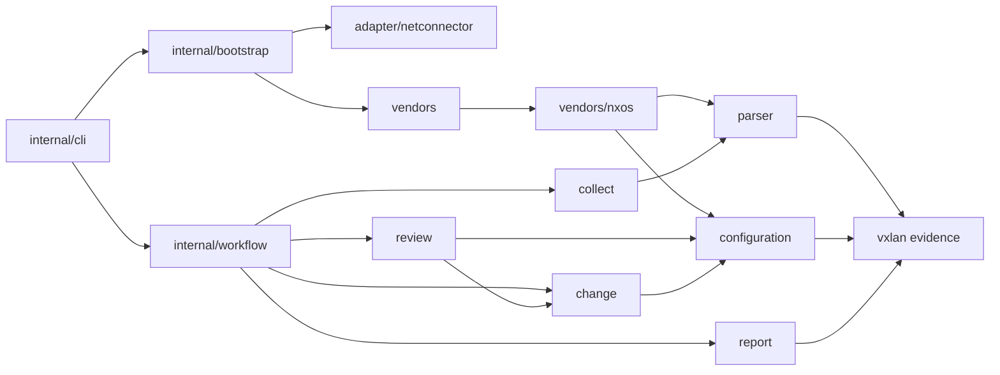

# VXLAN 模块职责

目录按网络运维能力组织；公共库不依赖终端、配置文件或具体传输。`cmd/vxlan` 只建立信号 context 和退出码边界，应用内部遵循与 net-connector 相同的 `internal/cli` 组织方式。

| 包 | 职责及主要入口 |
| --- | --- |
| `vxlan` 根包 | `Observation`、`Snapshot`、结构校验、严格 JSON 投影、规范指纹；不解析厂商语法或推导业务关系 |
| `parser` | `QuerySpec`、`ProfileSpec`、`Registry.Fetch`、独立的 `Profile`；有序查询声明生成维度顺序、命令索引与解析派发 |
| `vendors/nxos` | NX-OS 配置/运行态语法、来源文档、准备命令及有证据支持的空表策略；`cfgState.finalize` 保留在解析器内 |
| `vendors` | 显式构造内置 registry；没有 `init` 注册或可变全局 registry |
| `collect` | 按调用方选定的 profile 借用单设备会话，保留 Capture 与独立错误；不挑选厂商或创建传输 |
| `configuration` | ACL 依赖/绑定、子网索引、路由策略引用、业务目录与配置关系；不生成变更 |
| `review` | 设备/Fabric 诊断、业务候选推导、人工 NVE/EVPN 建议；验证命令来自传入的 profile 能力 |
| `change` | 三种可执行业务增量、NX-OS 渲染、不可变 ExecutionPlan、写前与读后验证；不连接设备 |
| `report` | 私有文件、精确 JSON、报告文本、原子发布和执行检查点；不决定业务候选 |
| `adapter/netconnector` | Connector 回执、操作 context、采集/配置会话适配；保留传输生命周期错误 |
| `internal/bootstrap` | YAML/.env/进程环境/CLI 分层、typed request、清单、凭据与依赖组合；复用 Connector 的库存配置 decoder |
| `internal/workflow` | 批量采集、离线 review；接收明确字段与能力，返回状态、事件与摘要 |
| `internal/workflow/apply` | 单项执行状态机；写前 intent、ack、回读、独立清理、uncertain 收尾 |
| `internal/cli` | Cobra 命令树、flag 适配、真实终端确认、展示、退出码；不持有工作流状态机 |

`configuration` 的 `acl.go`、`subnets.go`、`routing.go`、`services.go`、`relations.go` 按实际关系组织。共享 JSON 值操作集中在 `internal/record` 的 copy、json、values、collections 文件中，里面没有 ACL、厂商或业务算法。

## 依赖方向

`review.QueryCatalog` 由选定的 `parser.Profile` 满足：`Command(dimension)` 提供采集查询，`VerificationCommands(scope)` 提供按业务用途声明的核查序列。`ReviewFabric(documents, policy, queries)` 使用 `fabric` 核查序列，声明在 `vendors/nxos` 的 `ProfileSpec.Verification` 内；保留原有配置、VNI、各 VRF IP 接口三条命令。核查命令不增加采集维度，也不绑定虚构的解析器。缺少 Fabric 核查序列时保留诊断，但建议保持 blocked，不产生可执行增量。review 不导入厂商解析器，也不自行拼接替代命令。

`configuration.ReviewOrdered` 接受来源中的 VRF 顺序，使 NX-OS 解析器保留既有 JSON 数组顺序；普通映射消费者使用排序后的 `configuration.Review`。根证据包只验证结构，不反向依赖 configuration。

## 生命周期与所有权

bootstrap 的 `Settings` 在配置通过校验后生成，采集参数和连接选项以明确类型传入工作流；原始 `Values` 只承担配置展示与分层文档职责。连接凭据、库存来源与缓存选项、规则和设备筛选在加载时固定，设备行、维度和 Fabric policy 拥有独立副本。修改公开 `Values`、`Inventory`、`Environment`、`Policy` 或上次返回的设备行不会改变后续运行；更换凭据或配置应重新 Load。

应用配置和环境文件由 Connector `config.ReadFile(ctx, path, missingOK)` 读取，保留符号链接跟随规则，拒绝特殊文件和超过 16 MiB 的输入。`config.ParseYAMLMapping` 复用共享深度、节点和字节预算，并保持 VXLAN 的严格映射要求：空文件、仅注释、根 null 拒绝，显式 `{}` 允许。collect、apply、review 传递 caller context；帮助命令不加载文件。计划与报告证据 JSON 保留原有容量契约，读前后检查取消，不套用配置文件预算。

Profile 构造与选取复制查询、核查序列和覆盖表；命令、准备序列和访问器返回独立值。`QuerySpec` 同时给出维度、命令和解析器，顺序即默认采集顺序；型号覆盖按维度引用已有查询。采集、准备和核查命令使用同一控制字符校验。

`collect.OpenSession` 只允许同步、独占借用；连接与关闭归 adapter/Connector。完整 Capture 可同时携带后置错误，正文事实保留而 collection 不再宣称完整。业务证据、原始文件摘要和命令绑定各自验证，未知或不完整事实不能授权变更。

adapter 使用 Connector `Result.SingleAccepted` 校验单条已接受命令，使用 `StepResult.Body` 取得已验证正文。VXLAN 保留既有正文边界：去掉已确认 prompt 中包含的前导分隔换行，保留其余空行、缩进和正文中的同名命令行；不对正文做 TrimSpace。原始尝试的字节数、摘要与 hook 证据仍来自 `Attempts`，与后置执行错误分别保留。

离线 Review、ReadSources 与报告发布接收首个 context 参数。取消后停止新业务工作；已接受采集证据和执行 ack/uncertain 状态使用显式 `context.WithoutCancel` 完成收尾。批次最终事件或结果输出发生取消/写入失败时，会重新持久化对应摘要，返回的 Summary 与磁盘状态一致，不重放设备命令或输出。

ChangePlan 只接受 `svi_acl`、`svi_gateway_add`、`vlan_vni_add`。人工 NVE/EVPN 建议可写入候选脚本，但不进入可执行 changes。ExecutionPlan 重新渲染、绑定精确计划字节和目标配置指纹；apply 只接受已绑定单项，保持不重放、不重连、不自动回退、不保存配置。

apply 的可变执行事实由私有 `executionState` 持有：状态、pending 序号、已接受序号、验证摘要和失败代码均为明确字段。只在 Journal 和 Result 边界生成独立 Record，保留既有 JSON 字段、省略规则及空 steps 数组。日志消费者保留或修改收到的数据不能改变后续命令、执行状态和返回结果。

## 结构门禁

`python3 scripts/check-architecture.py` 使用 `go list -json` 的生产导入图，规则覆盖包及其子包：禁止公开 cli、根证据反向依赖、parser 引入 vendor、collect 自选传输、configuration/change 反向依赖，以及业务层直接引入文件/网络/终端库。领域/根包也检查传递依赖，不能通过 helper 隐藏应用或传输反向依赖；标准库 I/O 只检查直接导入，避免误判 fmt 等基础库。workflow 按直接能力边界禁止依赖 bootstrap、CLI、Cobra 或 Connector/Expect。`scripts/test_architecture.py` 用真实临时 Go 包图覆盖禁止、允许及 helper 绕过样例。CI 和独立交付检查都运行门禁与规则测试。

共享 inventory/config 与回执 API 来自正式 Connector v0.5.0；Expect 固定为 v0.4.2。默认构建与独立交付检查使用 `GOWORK=off`，不恢复本地依赖快照。仓库只维护当前架构、迁移与验证文档，旧实施计划及依赖来源记录通过 Git 历史查询。
