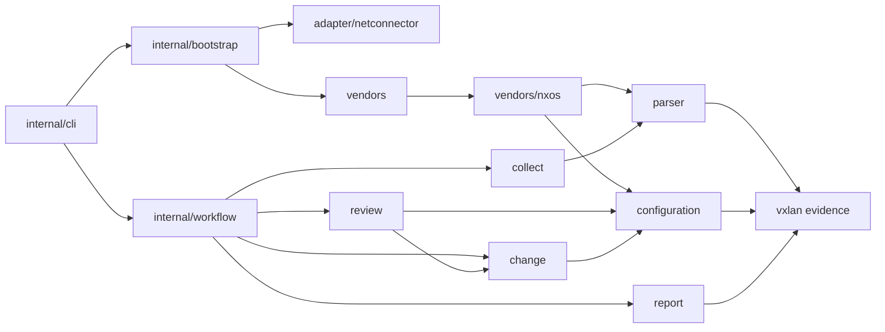

# VXLAN 模块职责

目录按网络运维能力组织；公共库不依赖终端、配置文件或具体传输。`cmd/vxlan` 只建立信号 context 和退出码边界，应用内部遵循与 net-connector 相同的 `internal/cli` 组织方式。

| 包 | 职责及主要入口 |
| --- | --- |
| `vxlan` 根包 | `Observation`、`Snapshot`、结构校验、严格 JSON 投影、规范指纹；不解析厂商语法或推导业务关系 |
| `parser` | `QuerySpec`、`ProfileSpec`、`Registry.Fetch`、独立的 `Profile`；有序查询声明生成维度顺序、命令索引与解析派发 |
| `vendors/nxos` | NX-OS 配置/运行态语法、来源文档、准备命令及有证据支持的空表策略；`cfgState.finalize` 保留在解析器内 |
| `vendors` | 显式构造内置 registry；没有 `init` 注册或可变全局 registry |
| `collect` | 按调用方选定的 profile 借用单设备会话，保留 Capture 与独立错误；不挑选厂商或创建传输 |
| `configuration` | ACL 依赖/绑定、子网索引、路由策略引用、业务目录与配置关系；不生成变更 |
| `review` | 设备/Fabric 诊断、业务候选推导、人工 NVE/EVPN 建议；验证命令来自传入的 profile 能力 |
| `change` | 三种可执行业务增量、NX-OS 渲染、不可变 ExecutionPlan、写前与读后验证；不连接设备 |
| `report` | 私有文件、精确 JSON、报告文本、原子发布和执行检查点；不决定业务候选 |
| `adapter/netconnector` | Connector 回执、操作 context、采集/配置会话适配；保留传输生命周期错误 |
| `fabric` | 类型化 VXLAN/EVPN 领域模型（配置、运行态、设备、Fabric 成员与角色、L2 服务视图）；严格解码解析器输出，未知字段使维度降为 partial（`unmodeled_fact`），不静默丢弃事实 |
| `rules` | 基于 go-netops `assess` 的风险规则目录：设备规则 `Rule[*fabric.Device]` 与 Fabric 规则 `Rule[*fabric.Fabric]`；输出 schema 3 `assessment.json`（严重级别、类别、对象路径、复核命令、修复建议、规则覆盖） |
| `internal/bootstrap` | YAML/.env/进程环境/CLI 分层、typed request、清单、凭据与依赖组合；复用 Connector 的库存配置 decoder |
| `internal/workflow` | 批量采集、离线 review；接收明确字段与能力，返回状态、事件与摘要 |
| `internal/workflow/apply` | 单项执行状态机；写前 intent、ack、回读、独立清理、uncertain 收尾 |
| `internal/cli` | Cobra 命令树、flag 适配、真实终端确认、展示、退出码；不持有工作流状态机 |

`configuration` 的 `acl.go`、`subnets.go`、`routing.go`、`services.go`、`relations.go` 按实际关系组织。共享 JSON 值操作集中在 `internal/record` 的 copy、json、values、collections 文件中，里面没有 ACL、厂商或业务算法。

## 依赖方向

`review.QueryCatalog` 由选定的 `parser.Profile` 满足：`Command(dimension)` 提供采集查询，`VerificationCommands(scope)` 提供按业务用途声明的核查序列。`ReviewFabric(documents, policy, queries)` 使用 `fabric` 核查序列，声明在 `vendors/nxos` 的 `ProfileSpec.Verification` 内；保留原有配置、VNI、各 VRF IP 接口三条命令。核查命令不增加采集维度，也不绑定虚构的解析器。缺少 Fabric 核查序列时保留诊断，但建议保持 blocked，不产生可执行增量。review 不导入厂商解析器，也不自行拼接替代命令。

`configuration.ReviewOrdered` 接受来源中的 VRF 顺序，使 NX-OS 解析器保留既有 JSON 数组顺序；普通映射消费者使用排序后的 `configuration.Review`。根证据包只验证结构，不反向依赖 configuration。

## 生命周期与所有权

bootstrap 的 `Settings` 在配置通过校验后生成，采集参数和连接选项以明确类型传入工作流；原始 `Values` 只承担配置展示与分层文档职责。连接凭据、库存来源与缓存选项、规则和设备筛选在加载时固定，设备行、维度和 Fabric policy 拥有独立副本。修改公开 `Values`、`Inventory`、`Environment`、`Policy` 或上次返回的设备行不会改变后续运行；更换凭据或配置应重新 Load。

应用配置和环境文件由 Connector `config.ReadFile(ctx, path, missingOK)` 读取，保留符号链接跟随规则，拒绝特殊文件和超过 16 MiB 的输入。`config.ParseYAMLMapping` 复用共享深度、节点和字节预算，并保持 VXLAN 的严格映射要求：空文件、仅注释、根 null 拒绝，显式 `{}` 允许。collect、apply、review 传递 caller context；帮助命令不加载文件。计划与报告证据 JSON 保留原有容量契约，读前后检查取消，不套用配置文件预算。

Profile 构造与选取复制查询、核查序列和覆盖表；命令、准备序列和访问器返回独立值。`QuerySpec` 同时给出维度、命令和解析器，顺序即默认采集顺序；型号覆盖按维度引用已有查询。采集、准备和核查命令使用同一控制字符校验。

`collect.OpenSession` 只允许同步、独占借用；连接与关闭归 adapter/Connector。完整 Capture 可同时携带后置错误，正文事实保留而 collection 不再宣称完整。业务证据、原始文件摘要和命令绑定各自验证，未知或不完整事实不能授权变更。

adapter 使用 Connector `Result.SingleAccepted` 校验单条已接受命令，使用 `StepResult.Body` 取得已验证正文。VXLAN 保留既有正文边界：去掉已确认 prompt 中包含的前导分隔换行，保留其余空行、缩进和正文中的同名命令行；不对正文做 TrimSpace。原始尝试的字节数、摘要与 hook 证据仍来自 `Attempts`，与后置执行错误分别保留。

离线 Review、ReadSources 与报告发布接收首个 context 参数。取消后停止新业务工作；已接受采集证据和执行 ack/uncertain 状态使用显式 `context.WithoutCancel` 完成收尾。批次最终事件或结果输出发生取消/写入失败时，会重新持久化对应摘要，返回的 Summary 与磁盘状态一致，不重放设备命令或输出。

ChangePlan 只接受 `svi_acl`、`svi_gateway_add`、`vlan_vni_add`。人工 NVE/EVPN 建议可写入候选脚本，但不进入可执行 changes。ExecutionPlan 重新渲染、绑定精确计划字节和目标配置指纹；apply 只接受已绑定单项，保持不重放、不重连、不自动回退、不保存配置。

apply 的可变执行事实由私有 `executionState` 持有：状态、pending 序号、已接受序号、验证摘要和失败代码均为明确字段。只在 Journal 和 Result 边界生成独立 Record，保留既有 JSON 字段、省略规则及空 steps 数组。日志消费者保留或修改收到的数据不能改变后续命令、执行状态和返回结果。

## 结构门禁

`python3 scripts/check-architecture.py` 使用 `go list -json` 的生产导入图，规则覆盖包及其子包：禁止公开 cli、根证据反向依赖、parser 引入 vendor、collect 自选传输、configuration/change 反向依赖，以及业务层直接引入文件/网络/终端库。领域/根包也检查传递依赖，不能通过 helper 隐藏应用或传输反向依赖；标准库 I/O 只检查直接导入，避免误判 fmt 等基础库。workflow 按直接能力边界禁止依赖 bootstrap、CLI、Cobra 或 Connector/Expect。`scripts/test_architecture.py` 用真实临时 Go 包图覆盖禁止、允许及 helper 绕过样例。CI 和独立交付检查都运行门禁与规则测试。

共享 inventory/config 与回执 API 来自正式 Connector v0.6.0；Expect 固定为 v0.5.0。默认构建与独立交付检查使用 `GOWORK=off`，不恢复本地依赖快照。仓库只维护当前架构、迁移与验证文档，旧实施计划及依赖来源记录通过 Git 历史查询。

## 类型化评估（schema 3）

`review` 在既有输出之外发布 `assessment.json`，并在 `summary.json` 中给出 `risk_counts`、`risk_highest` 与 `assessment_incomplete`。评估链路为：设备报告 → `fabric.DecodeDocument` → `fabric.Build`（按 Fabric 策略分配角色）→ `rules.Assessor`（两个 go-netops 引擎，一份规则策略）。

- 证据门禁由引擎统一执行：声明 `Requires` 的规则在证据不完整时记为 `skipped: insufficient_evidence`。运行态状态规则（NVE/BGP/OSPF/vPC/port-channel）从部分表中也会报告已观测到的故障，并在发现项中注明证据状态；`evidence_incomplete` 单独说明无法证明其余部分。
- 跨设备规则仅在全部声明成员的配置完整时运行，否则只产出 `vxlan.fabric_evidence_incomplete`，避免以部分成员的多数值误判离群设备。一致性规则使用 `drift.Consensus` 指出偏离多数的具体设备；无多数时全部标为 ambiguous。
- NVE/EVPN 关联修复属于人工脚本（`remediation.status: manual`），不进入自动执行白名单；自动执行仍仅 `svi_acl`、`svi_gateway_add`、`vlan_vni_add`。
- `--rules-policy FILE` 以 YAML 启用/禁用规则、覆盖严重级别和阈值；未知规则名或参数类型错误直接拒绝。

迁移按"影子运行"推进：已移植的检查由 `rules/parity_test.go` 在全部 `fabric`、`catalog`、`recommendations` 金样上与旧审查逐项对照；旧审查（`review`、`plan.json`）仍是变更计划的来源，未移植的检查（ACL 内容/绑定/依赖、地址组、网关冲突、子网重叠、RT 与租户路由、缺失映射推导）继续由旧审查产出，逐项移植后再下线。

## 基线与变化

- `vxlan baseline --batch DIR --fabric-policy FILE [--output FILE]` 由各 Fabric 当前多数值生成基线草案（Anycast 网关 MAC、SVI MTU、NVE、业务 VNI→VLAN、管理平面服务器）。多数值不等于正确值：草案须人工审核、删减后冻结；输出文件 0600 且不覆盖已有文件。
- `review --baseline FILE` 以 `vxlan.baseline_*` 规则报告偏离声明意图的配置（类别 `drift`）。与成员一致性不同，全体成员一致但偏离基线同样报告。未声明字段不检查；`defaults` 与 `fabrics.<名称>` 按字段覆盖。
- `review --previous DIR` 以 `vxlan.change_*` 规则逐设备比较两批证据：配置摘要、业务 VNI/VLAN、Up 的 NVE peer、已建立的 BGP 会话、FULL 的 OSPF 邻居、vPC 状态。任一侧证据不完整的维度不推断变化；仅出现在一批中的设备列入 `appeared` / `disappeared`，消失设备使评估标记为不完整。

## 运维配置扩展

`vendors/nxos` 的只读提取在配置记录中增加 `operations`：NTP/日志/TACACS/SNMP 服务器（不含密钥与 community）、NVE infra VLAN、VLAN 名称、trunk 放行列表、SVI DHCP 中继、fabric 端口与 vPC 域选项。提取不改变行状态与既有字段，Ruby 金样比较时剔除该字段。

`VXLAN_REAL_CORPUS=<目录>` 启用真实配置回归（`fabric/realcorpus_test.go`、`rules/realcorpus_test.go`）：全部配置须完整解析并无损建模，类型化规则须与旧审查逐项一致，派生基线须可往返，同批自比较须无变化。测试只输出聚合统计，设备数据不进入仓库。

## 可执行增量（类型化）

`change` 中的 `SVIGateway`、`VLANVNI`、`SVIACL` 实现 go-netops `change.Change` 与 `Preserving`：命令、回退、准入（Eligible）、回读（Satisfied）与"除目标外配置未变"（Preserved）均与旧 `ChangePlan` 一致。`rules.Increments` 复现旧 Fabric 审查的增量推导（网关、ACL、缺失 VLAN 映射；承载冲突、网段冲突、角色冲突与缺少验证命令时不推导），审查流程据此生成 `plan.json` 的 `changes`，计划 ID、字段与执行计划校验不变；`assessment.json` 以 `vxlan.remediation_increment` 发现项附带候选修复。

类型化模型保留字段存在性：显式 false、空列表/空映射与缺失字段不同，回读保护与旧实现同样严格。等价性由三层测试保证：build/eligible/satisfied 金样；以金样为种子的 7425 次配置变异差分；Fabric 金样与真实配置（`VXLAN_REAL_CORPUS`）上 `plan.json` changes 与旧推导逐字节一致。旧推导保留在测试中作为参照，直至旧审查下线。
