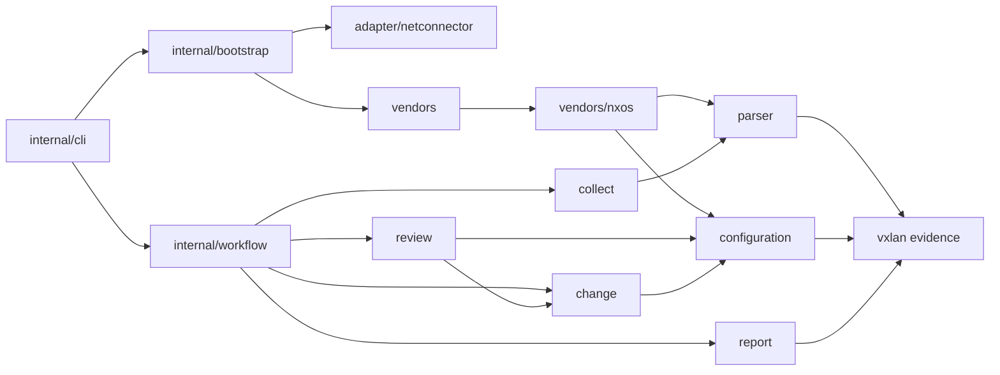

# VXLAN 模块职责

目录按网络运维能力组织；公共库不依赖终端、配置文件或具体传输。`cmd/vxlan` 只建立信号 context 和退出码边界，应用内部遵循与 net-connector 相同的 `internal/cli` 组织方式。

| 包 | 职责及主要入口 |
| --- | --- |
| `vxlan` 根包 | `Observation`、`Snapshot`、结构校验、严格 JSON 投影、规范指纹；不解析厂商语法或推导业务关系 |
| `parser` | `QuerySpec`、`ProfileSpec`、`Registry.Fetch`、独立的 `Profile`；有序查询声明生成维度顺序、命令索引与解析派发 |
| `vendors/nxos` | NX-OS 配置/运行态语法、来源文档、准备命令及有证据支持的空表策略；`cfgState.finalize` 保留在解析器内 |
| `vendors` | 显式构造内置 registry；没有 `init` 注册或可变全局 registry |
| `collect` | 按调用方选定的 profile 借用单设备会话，保留 Capture 与独立错误；不挑选厂商或创建传输 |
| `configuration` | ACL 依赖/绑定、子网索引、路由策略引用、业务目录与配置关系；不生成变更 |
| `review` | 设备/Fabric 诊断、业务候选推导、人工 NVE/EVPN 建议；验证命令来自传入的 profile 能力 |
| `change` | 三种可执行业务增量、NX-OS 渲染、不可变 ExecutionPlan、写前与读后验证；不连接设备 |
| `report` | 私有文件、精确 JSON、报告文本、原子发布和执行检查点；不决定业务候选 |
| `adapter/netconnector` | Connector 回执、操作 context、采集/配置会话适配；保留传输生命周期错误 |
| `internal/bootstrap` | YAML/.env/进程环境/CLI 分层、typed request、清单、凭据与依赖组合；复用 Connector 的库存配置 decoder |
| `internal/workflow` | 批量采集、离线 review；接收明确字段与能力，返回状态、事件与摘要 |
| `internal/workflow/apply` | 单项执行状态机；写前 intent、ack、回读、独立清理、uncertain 收尾 |
| `internal/cli` | Cobra 命令树、flag 适配、真实终端确认、展示、退出码；不持有工作流状态机 |

`configuration` 的 `acl.go`、`subnets.go`、`routing.go`、`services.go`、`relations.go` 按实际关系组织。共享 JSON 值操作集中在 `internal/record` 的 copy、json、values、collections 文件中，里面没有 ACL、厂商或业务算法。

## 依赖方向

`review.QueryCatalog` 是其消费的小接口，由选定的 `parser.Profile` 满足。review 因此不再维护第二张采集命令表，也不导入厂商解析器。当前 NX-OS 查询均以设备为范围，不增加没有业务含义的 scope 参数；后续多范围查询应由相应厂商声明，而非 CLI 拼接命令。

`configuration.ReviewOrdered` 接受来源中的 VRF 顺序，使 NX-OS 解析器保留既有 JSON 数组顺序；普通映射消费者使用排序后的 `configuration.Review`。根证据包只验证结构，不反向依赖 configuration。

## 生命周期与所有权

bootstrap 的 `Settings` 在配置通过校验后生成，采集参数和连接选项以明确类型传入工作流；原始 `Values` 只承担配置展示与分层文档职责。

Profile 构造与选取复制查询和覆盖表；命令、准备序列和访问器返回独立值。`QuerySpec` 同时给出维度、命令和解析器，顺序即默认采集顺序；型号覆盖按维度引用已有查询。命令和准备命令使用同一控制字符校验。

`collect.OpenSession` 只允许同步、独占借用；连接与关闭归 adapter/Connector。完整 Capture 可同时携带后置错误，正文事实保留而 collection 不再宣称完整。业务证据、原始文件摘要和命令绑定各自验证，未知或不完整事实不能授权变更。

离线 Review、ReadSources 与报告发布接收首个 context 参数。取消后停止新业务工作；已接受采集证据和执行 ack/uncertain 状态使用显式 `context.WithoutCancel` 完成收尾。批次最终事件或结果输出发生取消/写入失败时，会重新持久化对应摘要，返回的 Summary 与磁盘状态一致，不重放设备命令或输出。

ChangePlan 只接受 `svi_acl`、`svi_gateway_add`、`vlan_vni_add`。人工 NVE/EVPN 建议可写入候选脚本，但不进入可执行 changes。ExecutionPlan 重新渲染、绑定精确计划字节和目标配置指纹；apply 只接受已绑定单项，保持不重放、不重连、不自动回退、不保存配置。

## 结构门禁

`python3 scripts/check-architecture.py` 使用 `go list -json` 的生产导入图，禁止公开 cli、根证据反向依赖、parser 引入 vendor、collect 自选传输、configuration/change 反向依赖，以及业务层直接引入文件/网络/终端库。workflow 禁止依赖 bootstrap、CLI、Cobra 或 Connector。CI 和独立交付检查都运行该门禁。

共享 inventory/config API 来自正式 Connector v0.4.0；Expect 固定为 v0.4.1。默认构建与独立交付检查使用 `GOWORK=off`，不恢复本地依赖快照。仓库只维护当前架构、迁移与验证文档，旧实施计划及依赖来源记录通过 Git 历史查询。
